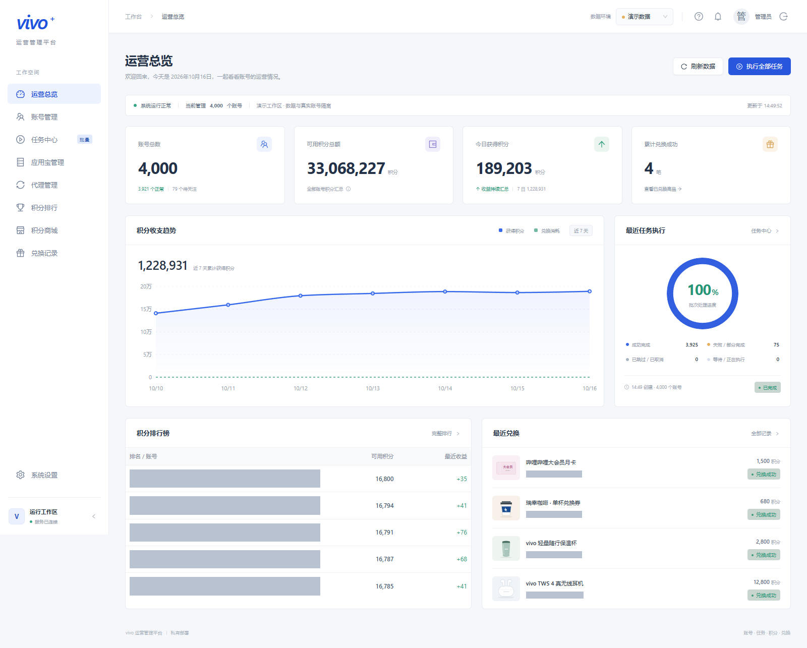
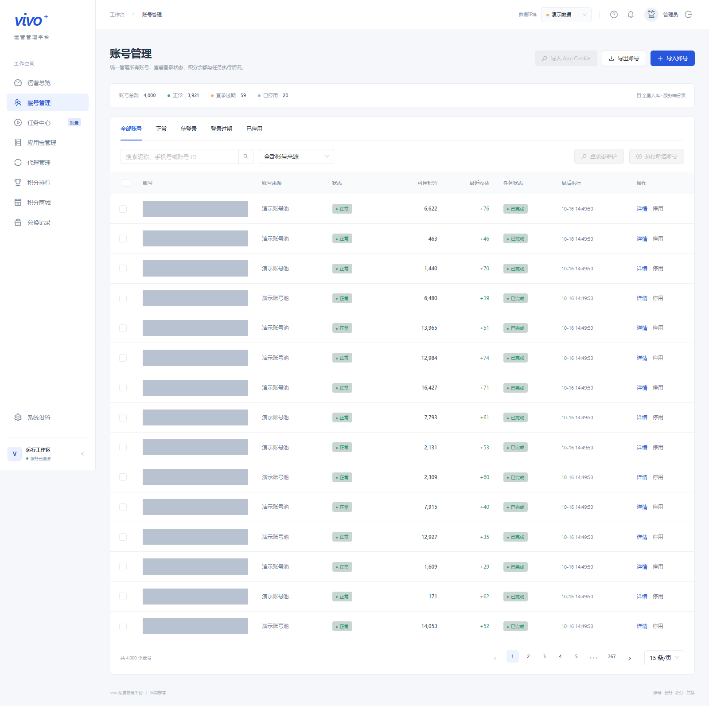
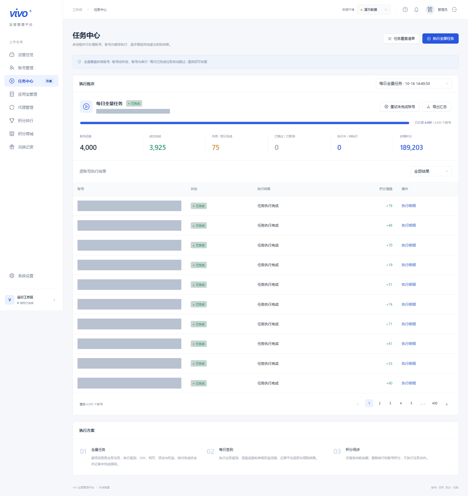
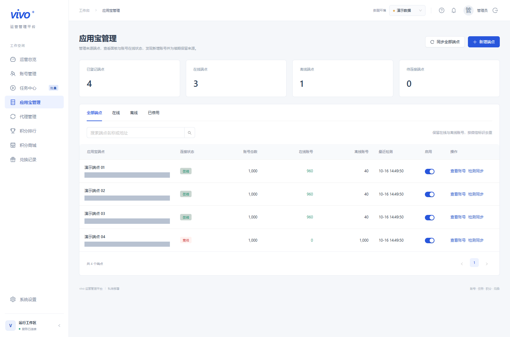
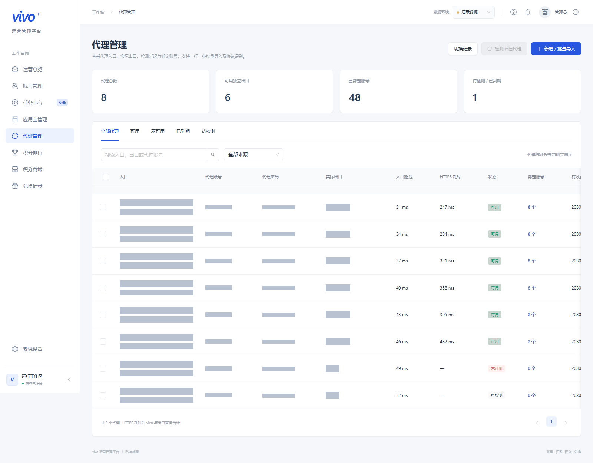
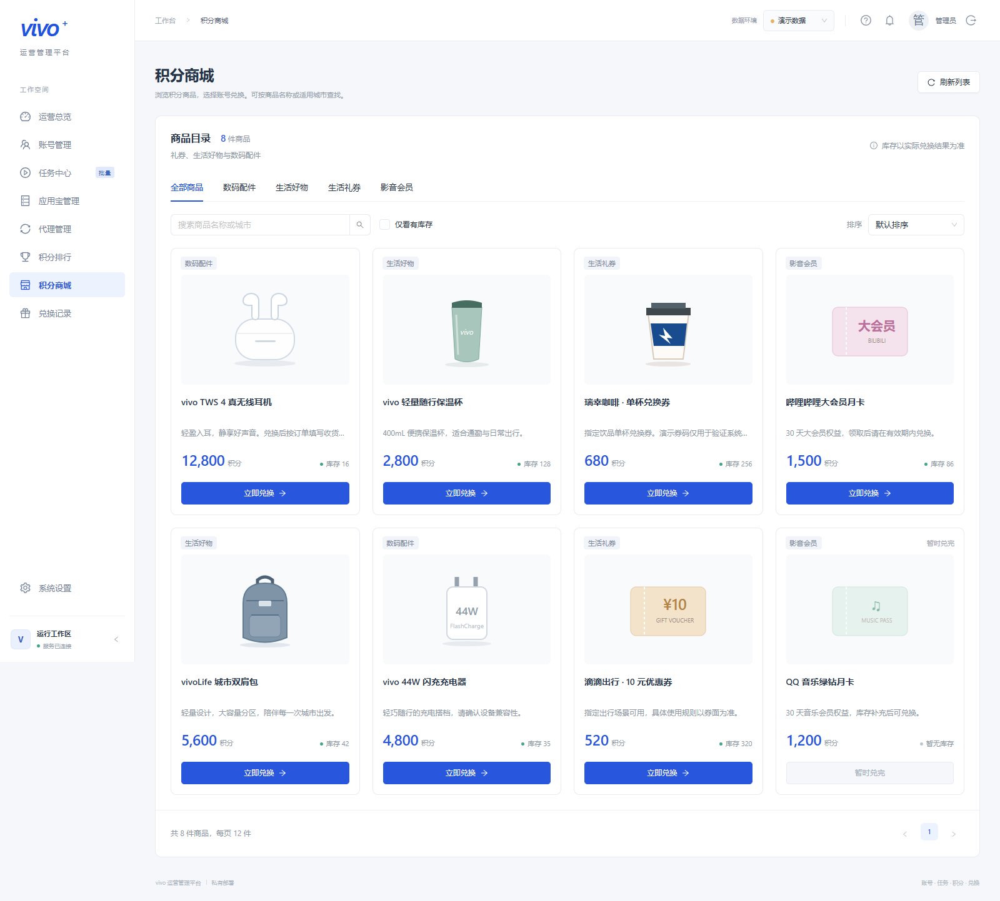
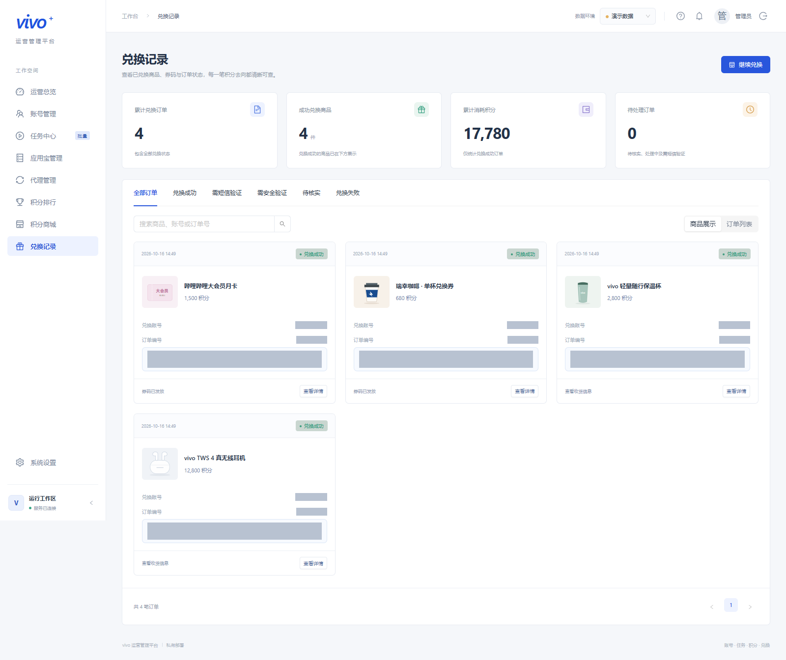

# vivo 运营管理平台

基于 **React + Ant Design + Flask** 的自部署管理平台，将账号、批次任务、代理、积分与兑换集中到一个工作台。

内置独立演示环境，可先体验界面与模拟流程，再配置自己的真实账号。服务运行不依赖开发者的原始工程或本机目录。



## 功能

| 模块 | 能力 |
| --- | --- |
| 运营总览 | 账号状态统计、积分余额与变化趋势、最近批次及兑换动态 |
| 账号管理 | 文件导入、去重、搜索筛选、分页导出、登录态维护及 App 会话导入 |
| 任务中心 | 全量、所选或抽样执行；暂停、继续、失败重试；逐步结果、耗时和请求数 |
| 应用宝管理 | 配置来源端点、检测同步、查看在线与离线账号、管理来源凭证 |
| 代理管理 | HTTP / SOCKS5 导入、入口与出口检测、有效期、账号绑定及切换记录 |
| 积分排行 | 按余额或收益排序，筛选账号并导出 |
| 积分商城 | 商品与城市筛选、价格库存更新、兑换预检及确认 |
| 兑换记录 | 订单状态、券码与使用说明、短信验证及待核实结果处理 |
| 系统设置 | 并发、执行进程、请求间隔、超时及后台维护配置 |

真实任务的可用性取决于平台接口、账号资格、登录态和设备条件。任务结果保留平台返回信息；积分以实际查询与到账记录为准。自动兑换和消耗积分的任务默认关闭，商城兑换需主动选择商品与账号。

## 界面预览

以下均为**独立演示库的实际页面截图**，不含真实运营数据。账号信息、批次标识、面板地址、代理入口与出口、代理凭证、订单标识和兑换结果均使用不透明色块遮蔽。

| 账号管理 | 任务中心 |
| --- | --- |
|  |  |

| 应用宝管理 | 代理管理 |
| --- | --- |
|  |  |

| 积分商城 | 兑换记录 |
| --- | --- |
|  |  |

截图中的数量、余额、商品、库存及订单均为模拟内容，不代表真实收益或实际可兑换权益。

## 快速开始

推荐使用 **Node.js 22** 和 **Python 3.13**。依赖分别通过 `package-lock.json` 与 `requirements.lock.txt` 锁定。

### Windows

在项目目录双击 `start.cmd`，或运行：

```powershell
py launch.py
```

启动器会创建 `.venv`、安装缺少的后端依赖，并在首次运行时安装前端依赖及构建页面。启动完成后自动打开 <http://127.0.0.1:8100>。不需要自动打开浏览器时使用 `py launch.py --no-browser`。

修改前端后需重新执行 `npm run build`，再刷新页面。

### Linux / macOS

```sh
python3 -m venv .venv
.venv/bin/python -m pip install -r requirements.lock.txt
npm ci
npm run build
.venv/bin/python server/app.py
```

访问 <http://127.0.0.1:8100>。

### 登录与演示

首次启动会生成随机管理口令，保存在 `data/admin-password.txt`。也可通过进程环境变量设置 `VIVO_ADMIN_PASSWORD` 或 `VIVO_ADMIN_PASSWORD_HASH`；优先使用散列配置。

登录后在右上角选择「演示数据」，可体验内置模拟账号、任务和商城；「真实账号」使用另一份数据库，需自行导入和配置。

## 配置

| 环境变量 | 默认值 | 说明 |
| --- | --- | --- |
| `VIVO_WEB_PORT` | `8100` | Web 服务端口 |
| `VIVO_BIND_HOST` | `127.0.0.1` | 监听地址 |
| `VIVO_DATA_DIR` | 项目下的 `data/` | 数据与密钥目录 |
| `VIVO_ADMIN_PASSWORD` | 空 | 自定义管理口令；留空时首次生成随机口令 |
| `VIVO_ADMIN_PASSWORD_HASH` | 空 | Werkzeug 支持的口令散列；优先于明文口令 |
| `VIVO_SECURE_COOKIE` | `0` | HTTPS 部署时设为 `1` |
| `VIVO_TRUST_PROXY` | `0` | 可信反向代理部署时设为 `1` |

本地启动读取**进程环境变量**，不会自动加载 `.env`。`.env.example` 是 Docker Compose 配置模板，不包含有效口令。

真实环境的常用配置顺序：

1. 在「应用宝管理」登记自己的端点，或在「账号管理」导入自己的账号文件。
2. 在「代理管理」导入代理并检测可用出口；真实环境默认要求可用代理。
3. 在「系统设置」按机器与网络资源调整并发、请求间隔和维护选项。
4. 先抽样执行并核对步骤结果、积分变化，再启动完整批次。

平台不会替用户完成短信、人机验证、真实交易或设备交互等必要前置条件。待核实的兑换需先查询原平台结果，再决定后续处理。

## Docker 部署

```sh
cp .env.example .env
mkdir -p data
# 容器使用 UID 10001，Linux 下将数据目录交给该用户。
sudo chown -R 10001:10001 data
docker compose up -d --build
```

默认只对宿主机 `127.0.0.1:8100` 开放。管理口令仍可从挂载目录的 `data/admin-password.txt` 获取；也可在本机 `.env` 中设置自己的口令。

需要 HTTPS 时，在 `.env` 设置域名 `VIVO_DOMAIN`，并设置 `VIVO_SECURE_COOKIE=1`、`VIVO_TRUST_PROXY=1`，再启动可选 Caddy 服务：

```sh
docker compose --profile https up -d --build
```

备份或迁移时保留**完整 `data/`**，其中的数据库、凭证加密密钥与管理会话配置属于同一套数据；仅复制数据库可能无法解密原有凭证。

## 开发与验证

后端：

```powershell
.\.venv\Scripts\python.exe server/app.py
```

前端开发服务：

```sh
npm ci
npm run dev
```

开发服务位于 `http://127.0.0.1:5173`，将 API 请求转发至本机 `8100` 后端。后端需先启动，并在后端登录页面完成登录。

```powershell
# 后端测试使用独立临时数据库
.\.venv\Scripts\python.exe -m pytest tests -q

# 类型检查与生产构建
npm run build

# 端到端测试使用独立测试服务与数据库；默认通过 Microsoft Edge 运行
npm run test:e2e

# 重新生成 README 截图，先完成构建
npm run screenshots:readme
```

Linux / macOS 下将 Python 命令替换为 `.venv/bin/python`。当前端到端配置使用 Windows Python 路径，其他系统需调整 `playwright.config.ts` 中的启动命令。

截图工具自动创建 `artifacts/readme-preview-*` 隔离目录，使用新生成的演示账号与本地服务，阻止浏览器访问外网，并直接输出遮蔽后的 PNG。它不读取 `data/` 中的真实数据库。默认浏览器为 Edge，可用 `VIVO_SCREENSHOT_BROWSER` 指定已安装的 Playwright 浏览器通道，用 `VIVO_SCREENSHOT_PYTHON` 指定 Python 路径。

## 项目结构

```text
src/                       React 页面、交互与样式
server/                    API、鉴权、存储、执行及业务服务
server/protocol/           任务协议与适配层
public/                    静态资源
scripts/                   可复用工具与本地运维脚本
  capture-readme-screenshots.mjs  隔离演示截图工具
tests/                     后端测试
e2e/                       浏览器端到端测试
deploy/                    HTTPS 反向代理配置
docs/screenshots/          已脱敏的公开截图
data/                      本机运行数据（不提交）
artifacts/                 测试、日志与临时产物（不提交）
```

执行层通过常驻多进程和异步槽位调度账号，使用 SQLite WAL、账号与出口租约、心跳及步骤断点协调并发和中断恢复。前端不保存管理口令；后端使用口令散列、HttpOnly / SameSite 会话 Cookie 与 CSRF 校验。账号凭证在本机加密保存，**代理凭证按产品设计明文存储并在登录后展示**。

## 公开内容与本机数据

`.gitignore` 排除运行数据库、密钥、环境配置、账号导入导出、抓包、日志、备份、内部验收文档和私有运维脚本；截图只允许明确列出的演示 PNG。`.dockerignore` 同时排除这些私有材料，避免进入镜像构建上下文。

现有 `docs/` 顶层文档属于内部研究和真实账号验收资料，仅留在本机。新增公开指南可放在 `docs/public/`；新增公开工具可放在 `scripts/public/`。运行必需的设备辅助脚本、离线检查工具及测试依赖工具已单独放行。原始账号资料和代理信息不作为项目示例发布。

忽略规则对已被 Git 跟踪的文件不生效。发布前应检查 `git status --short` 与 `git ls-files`；如在已有仓库中使用本项目，还需检查历史提交，确保未包含此前提交的私有材料。请勿使用 `git add -f` 强制加入本机数据。

## 许可证

本项目采用 [MIT License](LICENSE)。Copyright (c) 2026 vivo Operations Console contributors。

协议参考实现的来源与摘要记录于 `server/protocol/provenance.json` 和 `server/protocol/taskflow/source-manifest.json`。第三方代码原有的版权和许可声明予以保留。
